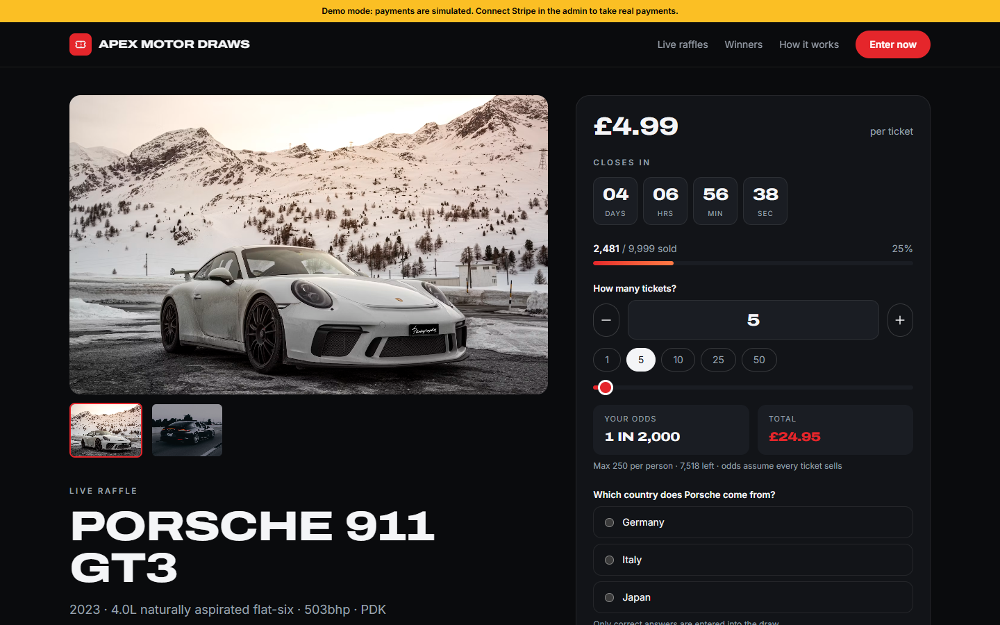
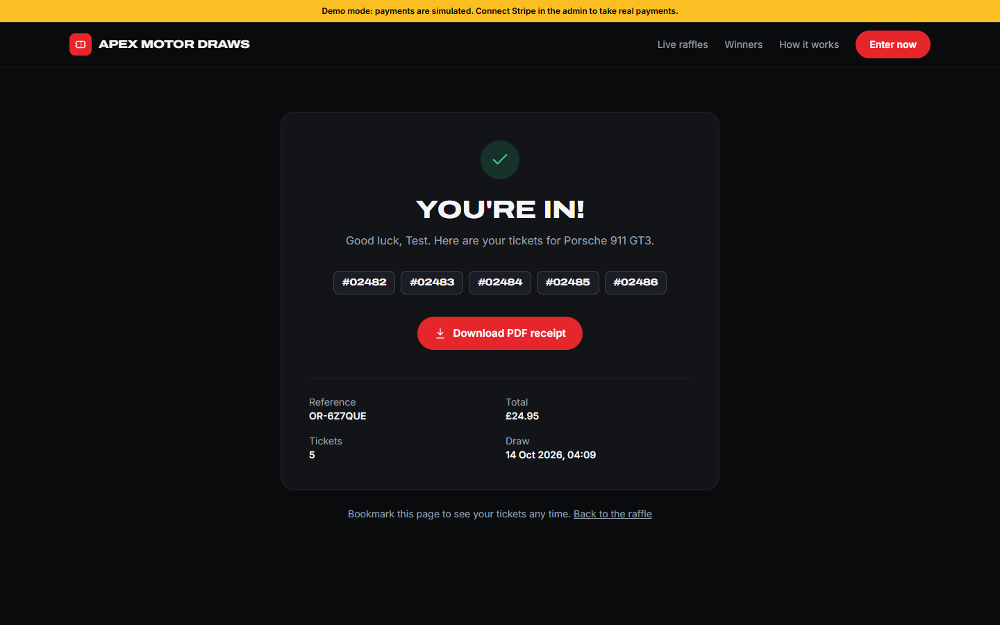
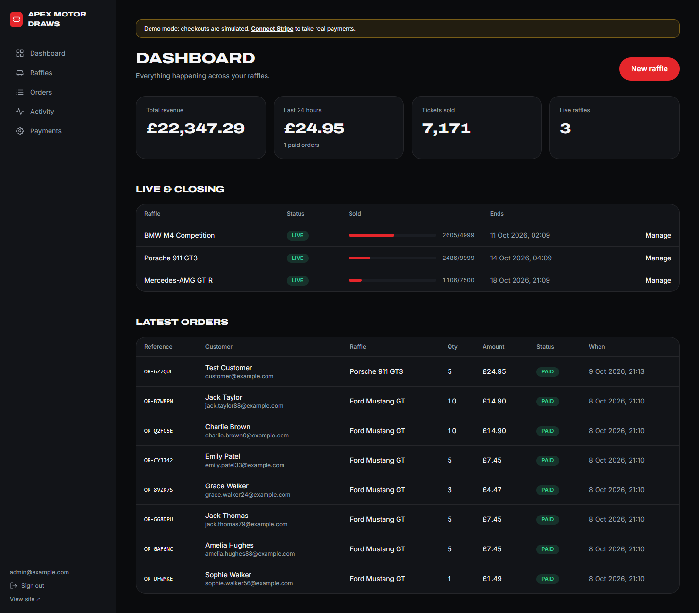
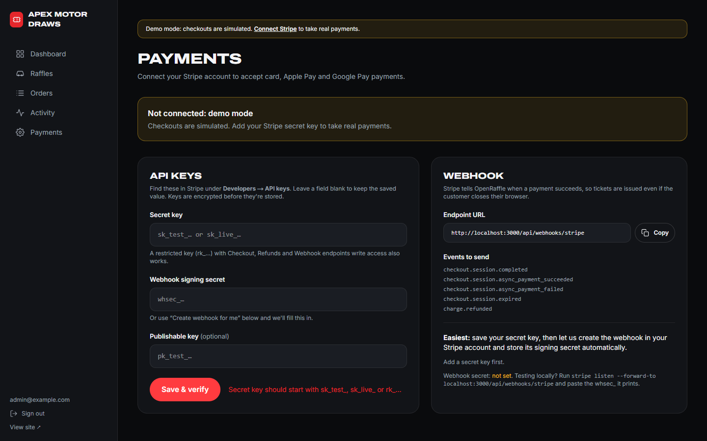
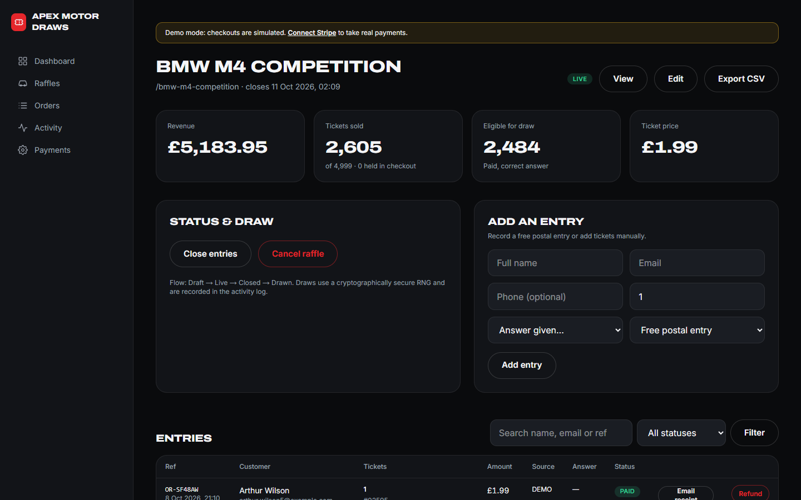
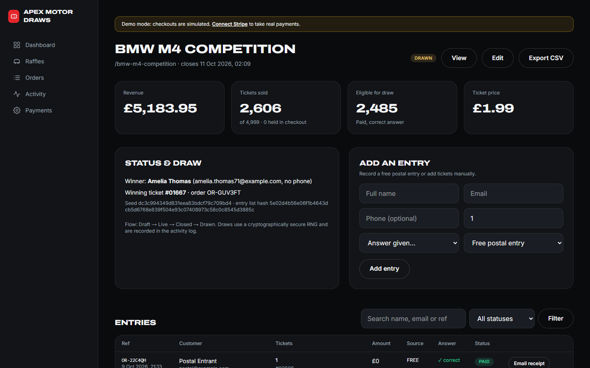
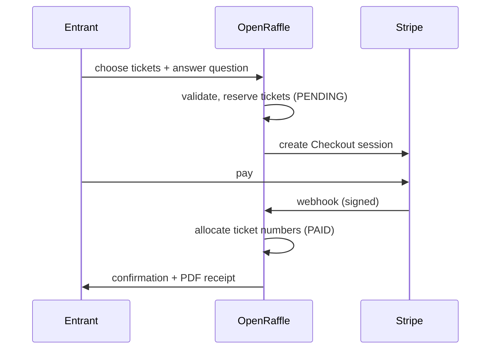

<div align="center">


# OpenRaffle

### Open-source car raffle & prize competition software for UK businesses

Launch your own online car competition website with **Stripe payments**, **instant PDF ticket receipts**, an **admin dashboard** and **provably fair draws**. Self-hosted, white-label and free.

[](LICENSE)
[](https://nextjs.org)
[](https://www.typescriptlang.org)
[](https://stripe.com)
[](#-testing)
[](#-uk-compliance-features)

[**Quick start**](#-quick-start) · [**Features**](#-features) · [**Screenshots**](#-screenshots) · [**How it works**](docs/HOW-IT-WORKS.md) · [**Deploy**](#-deployment) · [**Hire me**](#-need-help-hire-me)

</div>

---

## Why OpenRaffle?

Car competitions and prize draws are a booming online business in the UK, but getting one live usually means paying a platform a fee on every ticket or paying an agency for a custom build.

**OpenRaffle gives you the whole platform as open source.** It's a production-ready Next.js app you can brand as your own and host anywhere, with no per-ticket fees beyond Stripe's standard card processing.

It's built for:

- 🏁 **UK car competition companies** launching or replacing their website
- 🚗 **Dealerships, garages and car clubs** running promotional prize draws
- 🎗️ **Charities and community groups** raising money with prize competitions
- 🧑‍💻 **Developers and agencies** who want a tested foundation for client projects

> Not just cars: OpenRaffle works for **any prize competition**, such as tech, holidays, watches, cash or charity draws. Swap the copy and photos and you're done.

---

## ✨ Features

### For entrants
- **Beautiful, fast raffle pages** with photo gallery, specs, prize value and cash alternative
- **Live countdown timers** and **tickets-sold progress bars**
- **Interactive ticket picker**: quick presets, slider, live **odds calculator** and running total
- **Qualifying question** built into checkout
- **Secure Stripe Checkout**: cards, Apple Pay and Google Pay, with no card data on your server
- **Instant ticket numbers** with an animated confirmation page
- **Downloadable PDF receipt**, emailed automatically when SMTP is configured
- **Recent entries feed** and **winners showcase** for social proof
- **Mobile-first** design with a sticky "Enter now" bar
- **Branded social share images** generated automatically for every raffle (WhatsApp, Facebook, X)

### For operators (admin dashboard)
- **Revenue, tickets sold and 24-hour sales** at a glance
- **Create and edit raffles** with images, specs, pricing, ticket caps, per-person limits and dates
- **Raffle lifecycle**: Draft → Live → Closed → Drawn, plus cancel and reopen
- **One-click winner draw** with a published, verifiable draw record
- **Entries table** with search, status filters and ticket numbers
- **Add free postal entries** and manual (phone or cash) entries
- **Refunds** from the dashboard via the Stripe API
- **CSV export** of every ticket for your records or a live draw
- **Connect Stripe from the admin**: paste your keys (stored encrypted) and click **"Create webhook for me"**
- **Activity log** of every payment, entry, draw and admin action

### Reliability & security
- **Never oversells**: tickets are reserved during checkout, and a database constraint guarantees unique ticket numbers
- **Idempotent Stripe webhooks**: safe against retries and duplicate events
- **Automatic refunds** if a payment lands after a raffle has sold out
- **Cryptographically secure draws** (`crypto.randomInt`) with an entry-list fingerprint
- Signed admin sessions, rate-limited login and checkout, encrypted secrets, CSV injection protection
- **23 automated tests**, including database integration tests for payments and draws

### Developer friendly
- **Next.js 15**, React 19, TypeScript, Tailwind CSS 4, Prisma, Stripe, pdf-lib, Zod
- **Demo mode** works with zero configuration, no Stripe account needed
- **SQLite** for local development, **PostgreSQL** for production
- **White-label** through environment variables; colours are design tokens
- Docker and CI included

---

## 🇬🇧 UK compliance features

In Great Britain, online raffles are usually run as **prize competitions** or **free draws** so they fall outside the lottery licensing regime of the **Gambling Act 2005**. OpenRaffle includes the tools operators typically rely on:

| Requirement | How OpenRaffle handles it |
| --- | --- |
| **Skill or knowledge question** | Configurable per raffle. Only correct answers are entered into the draw |
| **Free entry route** | Built-in free postal entry page; admins record postcards as free entries with equal odds |
| **Age restriction** | Mandatory 18+ confirmation (configurable with `MIN_AGE`) |
| **Transparent odds** | Fixed maximum tickets shown on every raffle; live odds in the ticket picker |
| **Fair, auditable draw** | Secure RNG, published draw record and full audit log |
| **Clear terms** | Terms & conditions page template |
| **GBP by default** | `CURRENCY=gbp`, `LOCALE=en-GB` |

> ⚖️ **Not legal advice.** The rules on prize competitions are under active review. Read the [Gambling Commission's guidance](https://www.gamblingcommission.gov.uk) and have your terms checked by a solicitor before you launch. OpenRaffle can also be configured for other countries (for example, US sweepstakes with an alternative method of entry).

---

## 📸 Screenshots

| Home | Raffle & ticket picker |
| :---: | :---: |
|  |  |
| **Confirmation with ticket numbers** | **Mobile** |
|  |  |
| **Admin dashboard** | **Connect Stripe from the admin** |
|  |  |
| **Manage entries & draw** | **Winner & draw record** |
|  |  |

---

## 🚀 Quick start

Requires **Node.js 20+**.

```bash
git clone https://github.com/kapoordeepanshu/openraffle.git
cd openraffle
npm install
cp .env.example .env        # then set AUTH_SECRET and ADMIN_PASSWORD
npm run setup               # creates the database and loads demo raffles
npm run dev
```

- Website: **http://localhost:3000**
- Admin: **http://localhost:3000/admin** (log in with `ADMIN_EMAIL` / `ADMIN_PASSWORD` from `.env`)

Without Stripe keys the app runs in **demo mode**: checkout completes instantly so you can try the full journey, including ticket numbers, the PDF receipt and the draw.

Generate an `AUTH_SECRET`:

```bash
node -e "console.log(require('crypto').randomBytes(32).toString('hex'))"
```

---

## 💳 Connecting Stripe

**Option A: from the admin (recommended)**

1. Go to **Admin → Payments**.
2. Paste your **secret key** from Stripe (Developers → API keys). It's verified, then stored **encrypted**.
3. Click **"Create webhook for me"**. OpenRaffle registers the webhook in your Stripe account and saves the signing secret automatically. This needs your site on a public `https://` URL.
4. Click **Test connection**. Use test keys and card `4242 4242 4242 4242` until you're ready to go live.

**Option B: environment variables**

```bash
STRIPE_SECRET_KEY="sk_live_..."
STRIPE_WEBHOOK_SECRET="whsec_..."
```

Webhook endpoint: `https://your-domain/api/webhooks/stripe`. Events: `checkout.session.completed`, `checkout.session.async_payment_succeeded`, `checkout.session.async_payment_failed`, `checkout.session.expired`, `charge.refunded`.

**Testing webhooks locally** with the [Stripe CLI](https://stripe.com/docs/stripe-cli):

```bash
stripe listen --forward-to localhost:3000/api/webhooks/stripe
# paste the whsec_... it prints into Admin → Payments
```

---

## ⚙️ Configuration

All settings live in `.env` (see [`.env.example`](.env.example)).

| Variable | Default | Description |
| --- | --- | --- |
| `DATABASE_URL` | `file:./dev.db` | SQLite file or PostgreSQL URL |
| `SITE_URL` | `http://localhost:3000` | Public URL, used for Stripe redirects and receipts |
| `ADMIN_EMAIL` / `ADMIN_PASSWORD` | | Admin login |
| `AUTH_SECRET` | | 32+ random characters; signs sessions and encrypts stored keys |
| `SITE_NAME`, `SITE_TAGLINE`, `LEGAL_NAME` | Apex Motor Draws | Branding |
| `SUPPORT_EMAIL` | | Shown in the footer and on receipts |
| `CURRENCY` / `LOCALE` | `gbp` / `en-GB` | Money and date formatting |
| `MIN_AGE` | `18` | Age confirmation on entry |
| `FREE_ENTRY_ENABLED` / `FREE_ENTRY_ADDRESS` | `true` | Free postal entry route |
| `STRIPE_SECRET_KEY` / `STRIPE_WEBHOOK_SECRET` | | Optional if you connect Stripe in the admin |
| `PAYMENTS_MODE` | auto | Force `demo` or `stripe` |
| `RESERVATION_MINUTES` | `30` | How long checkout holds tickets |
| `AUTO_REFUND_OVERSOLD` | `true` | Refund payments that arrive after a sell-out |
| `SMTP_URL` / `MAIL_FROM` | | Optional email receipts via any SMTP provider |

**Branding colours** are design tokens in [`src/app/globals.css`](src/app/globals.css) (`--color-accent`, `--color-bg`, …).

---

## 🌍 Deployment

### Vercel + PostgreSQL
1. Create a Postgres database (Neon, Supabase, Vercel Postgres…).
2. In `prisma/schema.prisma` set `provider = "postgresql"`.
3. Import the repo into Vercel and add your environment variables.
4. Run `npx prisma db push` once against the production database.

### Docker (any VPS)
```bash
docker compose up -d --build
```
Data is stored in a Docker volume (SQLite). Put it behind a reverse proxy with HTTPS (Caddy, Nginx, Traefik).

### Going live checklist
- [ ] Strong `ADMIN_PASSWORD` and a fresh `AUTH_SECRET`
- [ ] `SITE_URL` set to your real `https://` domain
- [ ] Live Stripe keys connected and the webhook created
- [ ] Terms & conditions and free entry address reviewed for your business
- [ ] `SMTP_URL` configured so entrants receive their receipts
- [ ] Demo data removed (create your own raffles and delete the samples)

---

## 🧠 How it works

The full walkthrough is in **[docs/HOW-IT-WORKS.md](docs/HOW-IT-WORKS.md)**, with diagrams for checkout, webhooks, ticket allocation, the draw and the admin.



---

## 🧪 Testing

```bash
npm test          # unit + database integration tests (Vitest)
npm run typecheck
npm run lint
```

Covered: sequential ticket allocation, webhook idempotency, reservation expiry, overselling protection, per-person limits, draw eligibility and double-draw protection, PDF generation, validation, secret encryption and rate limiting.

---

## 🗺️ Roadmap

- [ ] Instant-win tickets
- [ ] Discount codes and bundle pricing (e.g. 10 tickets for £15)
- [ ] Customer accounts with ticket history
- [ ] Live-draw mode (full-screen ticket reveal for streaming)
- [ ] Multi-tenant mode (one install, many brands)
- [ ] Additional payment providers

Have an idea? [Open an issue](https://github.com/kapoordeepanshu/openraffle/issues).

---

## ❓ FAQ

<details>
<summary><strong>Is OpenRaffle really free?</strong></summary>

Yes. It's MIT-licensed, so you can use it commercially, modify it and host it anywhere. You only pay your hosting and Stripe's standard processing fees.
</details>

<details>
<summary><strong>Is it legal to run car raffles in the UK?</strong></summary>

Many UK businesses run car competitions legally as prize competitions or free draws, typically with a genuine skill question and/or a free entry route. OpenRaffle supports both. The law is complex and changing, so take legal advice for your situation before launching. This project isn't legal advice.
</details>

<details>
<summary><strong>Do I need a Stripe account to try it?</strong></summary>

No. Without keys it runs in demo mode with simulated payments, so you can test the complete flow. Connect Stripe in **Admin → Payments** when you're ready.
</details>

<details>
<summary><strong>How is the winner chosen, and can entrants trust it?</strong></summary>

A cryptographically secure random number generator picks one ticket from all eligible entries (paid or free, with a correct answer, not refunded). The raffle page publishes a draw record: entry count, a SHA-256 fingerprint of the entry list, the seed and the winning number. Every draw is also written to the audit log.
</details>

<details>
<summary><strong>What stops a raffle from being oversold?</strong></summary>

Tickets are reserved while a customer is in checkout, capacity is checked inside a database transaction, and ticket numbers are protected by a unique constraint. If a slow payment arrives after a sell-out, it's refunded automatically instead of being over-issued.
</details>

<details>
<summary><strong>Can I use it for prizes other than cars?</strong></summary>

Absolutely. Nothing in the core logic is car-specific. Change the copy, photos and specs to run competitions for tech, holidays, watches, cash or charity prizes.
</details>

<details>
<summary><strong>Can I change the look to match my brand?</strong></summary>

Yes. Set your name and details with environment variables, and change colours and fonts through the design tokens in `globals.css`. If you'd like it done for you, see [Hire me](#-need-help-hire-me).
</details>

<details>
<summary><strong>Which database should I use in production?</strong></summary>

PostgreSQL is recommended for production. SQLite is fine for development and small single-server deployments.
</details>

---

## 🤝 Need help? Hire me

I'm **Deepanshu Kapoor**, the developer behind OpenRaffle. If you'd rather not set it up yourself, or need something bespoke, I can help:

- ✅ **Installation & launch**: hosting, domain, SSL, database, Stripe and email set up for you
- 🎨 **Branding & design**: your logo, colours and pages to match your business
- 🧩 **Custom features**: instant wins, discount codes, customer accounts, live draws, integrations
- 🔄 **Migration**: move your existing competition site and data across
- 🛠️ **Ongoing support & maintenance**

📧 **Email:** [deepanshukapoor756@gmail.com](mailto:deepanshukapoor756@gmail.com?subject=OpenRaffle%20enquiry)
🐙 **GitHub:** [@kapoordeepanshu](https://github.com/kapoordeepanshu)

If OpenRaffle helps you, please ⭐ **star the repo**. It helps other businesses find it.

---

## Contributing

Contributions are welcome! See [CONTRIBUTING.md](CONTRIBUTING.md). Found a security issue? Please follow [SECURITY.md](SECURITY.md) instead of opening a public issue.

## License

[MIT](LICENSE) © Deepanshu Kapoor

<sub>Keywords: car raffle software, car competition website, UK prize competition platform, online raffle script, open source raffle system, Stripe raffle, Next.js raffle, giveaway website, prize draw software, competition website builder.</sub>
