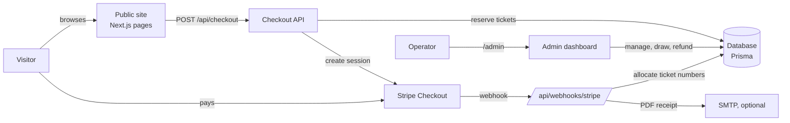
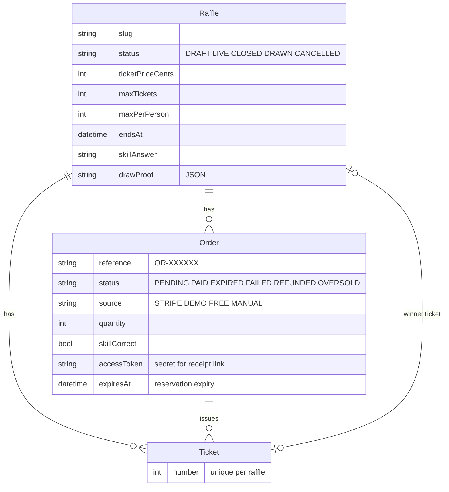
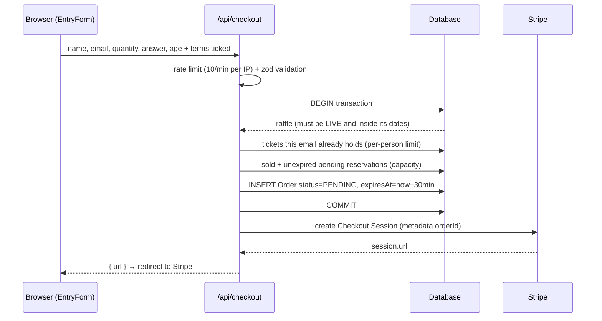
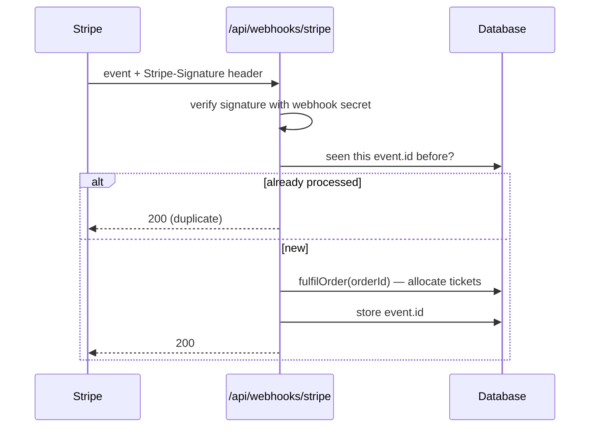
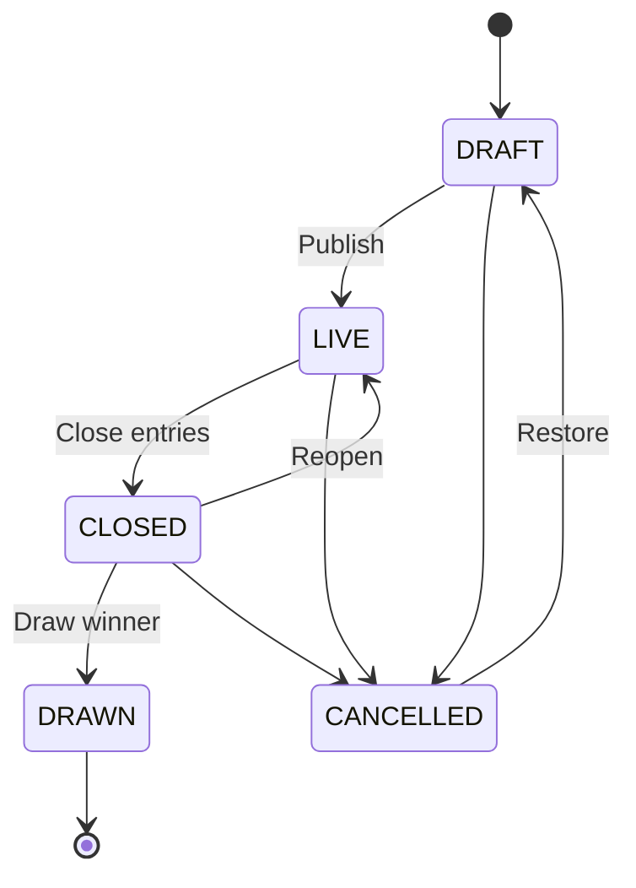

# How OpenRaffle works

This guide explains the project logic end to end: what happens when someone buys a ticket, how payments are confirmed, how ticket numbers are allocated without overselling, and how a winner is drawn. Read it alongside the code; every section names the files involved.

- [1. The big picture](#1-the-big-picture)
- [2. Data model](#2-data-model)
- [3. Entering a raffle (checkout)](#3-entering-a-raffle-checkout)
- [4. Confirming payment (Stripe webhook)](#4-confirming-payment-stripe-webhook)
- [5. Ticket allocation and overselling](#5-ticket-allocation-and-overselling)
- [6. Free postal and manual entries](#6-free-postal-and-manual-entries)
- [7. Drawing a winner](#7-drawing-a-winner)
- [8. Receipts and emails](#8-receipts-and-emails)
- [9. Admin, sessions and Stripe settings](#9-admin-sessions-and-stripe-settings)
- [10. Raffle lifecycle](#10-raffle-lifecycle)
- [11. Where things live](#11-where-things-live)
- [12. Adapting it to other prizes or businesses](#12-adapting-it-to-other-prizes-or-businesses)

---

## 1. The big picture



There are three moving parts:

1. **Public site**: lists raffles and takes entries. It never trusts the browser for anything that matters: price, capacity and the qualifying answer are all re-checked on the server.
2. **Stripe**: takes the money. OpenRaffle uses hosted Stripe Checkout, so card details never touch your server.
3. **Webhook**: the only place where an order becomes `PAID` and gets ticket numbers. The success page you land on after paying just *displays* the order; it doesn't confirm it.

> **Demo mode.** With no Stripe key configured, `paymentsMode()` returns `"demo"` and the checkout API confirms the order immediately instead of redirecting to Stripe. Everything else (allocation, receipts, draw) runs exactly as in production.

## 2. Data model



Also in [`prisma/schema.prisma`](../prisma/schema.prisma):

| Model | Purpose |
| --- | --- |
| `WebhookEvent` | Stripe event ids already handled, for idempotency |
| `AuditLog` | Every payment, entry, draw, refund and admin action |
| `Setting` | Key/value settings from the admin. Stripe secrets are stored **encrypted** |

Money is always stored as **integer pence** (`*Cents` fields) to avoid floating-point errors.

## 3. Entering a raffle (checkout)



Code: [`src/app/api/checkout/route.ts`](../src/app/api/checkout/route.ts) → `createPendingOrder()` in [`src/lib/orders.ts`](../src/lib/orders.ts).

Key rules enforced on the server:

- **Open window**: `status === "LIVE"` and `startsAt <= now < endsAt` (`isOpenForEntries`).
- **Per-person limit**: sums `PAID` + `PENDING` quantities for the email address.
- **Capacity**: `remaining = maxTickets − sold − reserved`, where *reserved* is the quantity in `PENDING` orders whose `expiresAt` is still in the future. This is what stops two people buying the last tickets at the same time.
- **Qualifying question**: the answer must be one of the options. Whether it's *correct* is stored as `skillCorrect`. Wrong answers can still pay (as with most UK competitions) but are **excluded from the draw**.

## 4. Confirming payment (Stripe webhook)



Code: [`src/app/api/webhooks/stripe/route.ts`](../src/app/api/webhooks/stripe/route.ts).

| Event | What happens |
| --- | --- |
| `checkout.session.completed` (paid) | `fulfilOrder()` → tickets issued, receipt emailed |
| `checkout.session.async_payment_succeeded` | same, for delayed payment methods |
| `checkout.session.async_payment_failed` | order → `FAILED` |
| `checkout.session.expired` | order → `EXPIRED`, its reservation is released |
| `charge.refunded` (full) | order → `REFUNDED`, its tickets are excluded from the draw |

**Why it's safe to receive an event twice:** Stripe retries webhooks. There are two layers of protection: the `WebhookEvent` table skips known event ids, and `fulfilOrder()` itself does nothing if the order is already `PAID`. If the handler throws, we return `500` so Stripe retries later.

## 5. Ticket allocation and overselling

`fulfilOrder()` in [`src/lib/orders.ts`](../src/lib/orders.ts) runs inside a database transaction:

1. Load the order. If it's already `PAID`, stop (idempotent).
2. Count tickets already issued for the raffle. If `sold + quantity > maxTickets`, mark the order **`OVERSOLD`** and stop. The webhook then refunds it automatically (`AUTO_REFUND_OVERSOLD`).
3. Find the highest ticket number so far and insert `quantity` tickets numbered sequentially after it.
4. Mark the order `PAID`.

The table has a **unique constraint on `(raffleId, number)`**. If two payments are confirmed at the same instant and both try to use ticket #501, one insert fails with Prisma error `P2002`; that transaction is simply retried with fresh numbers (up to 5 times). You never get duplicate ticket numbers, and you never issue more than `maxTickets`.

How can an order become `OVERSOLD` at all? Reservations expire after `RESERVATION_MINUTES` (30 by default). If someone sits on the Stripe payment page past that, their tickets are released and may be sold to someone else. When their payment finally lands, there may be no room left, so they're refunded rather than over-issued.

## 6. Free postal and manual entries

UK prize competitions usually offer a free entry route. In the admin (`Raffle → Add an entry`) the operator records a postcard as a **FREE** entry, or a phone/cash sale as **MANUAL**. Both go through the same `createPendingOrder()` → `fulfilOrder()` path with `amountCents = 0`, so they get real ticket numbers, respect capacity and limits, and have the same chance of winning.

## 7. Drawing a winner

Code: [`src/lib/draw.ts`](../src/lib/draw.ts).

1. The raffle must be **`CLOSED`** (closing is a separate, deliberate step).
2. Collect **eligible tickets**: order `status = PAID` and `skillCorrect = true`. Refunded, oversold, failed and wrong-answer tickets are excluded.
3. Sort tickets by number and compute `entryListHash = sha256("1,2,3,…")`, a fingerprint of exactly who was in the draw.
4. Pick an index with Node's **`crypto.randomInt`** (cryptographically secure, unbiased).
5. Save the winner with a conditional update `WHERE status = 'CLOSED' AND winnerTicketId IS NULL`, so two admins clicking "Draw" at once can't create two winners.
6. Store a **draw record** (entry count, hash, seed, winning index and number, timestamp) on the raffle and in the audit log. The public raffle page shows it.

`pickWinner()` is a pure function that takes an RNG, which is why it can be unit-tested deterministically.

## 8. Receipts and emails

- [`src/lib/receipt.ts`](../src/lib/receipt.ts) builds an A4 PDF with **pdf-lib** (no headless browser needed). Large orders flow onto extra pages.
- `GET /api/orders/:id/receipt?token=…` serves it. The `accessToken` is a random 192-bit secret created with the order, so receipts can't be guessed or enumerated.
- If `SMTP_URL` is set, [`src/lib/mail.ts`](../src/lib/mail.ts) emails the receipt as soon as an order is paid. Admins can re-send it from the entries table.

## 9. Admin, sessions and Stripe settings

- **Login**: `ADMIN_EMAIL` / `ADMIN_PASSWORD`, compared in constant time and rate-limited (5 attempts per 15 minutes per IP).
- **Session**: a signed JWT (HS256, `AUTH_SECRET`) in an `httpOnly`, `sameSite=lax` cookie, valid for 12 hours.
- **Protection is layered**: [`src/middleware.ts`](../src/middleware.ts) guards `/admin/*` and `/api/admin/*`, and every server action in [`src/app/admin/actions.ts`](../src/app/admin/actions.ts) calls `requireAdmin()` again.
- **Stripe from the admin**: `Admin → Payments` saves keys **encrypted with AES-256-GCM** (key derived from `AUTH_SECRET`) in the `Setting` table. The secret key is verified against Stripe before it's saved. "Create webhook for me" calls Stripe's API to register the endpoint and stores the signing secret it returns. Settings saved in the admin take priority over environment variables.
- **CSV export** neutralises spreadsheet formula injection (cells starting with `=`, `+`, `-` or `@`).

## 10. Raffle lifecycle



Allowed transitions are listed in `TRANSITIONS` in `src/app/admin/actions.ts`. A raffle whose `endsAt` has passed stops accepting entries automatically, even if nobody has closed it yet.

## 11. Where things live

```
prisma/
  schema.prisma          data model
  seed.ts                demo raffles and orders
src/
  config.ts              branding & business settings (from env)
  middleware.ts          admin route guard
  lib/
    orders.ts            reserve → fulfil → free entries  ← core logic
    draw.ts              winner selection + proof
    raffle.ts            capacity maths, JSON field helpers
    stripe.ts            Stripe client + Checkout session
    settings.ts          Stripe keys from admin/env, payments mode
    crypto.ts            AES-256-GCM for stored secrets
    receipt.ts           PDF generation
    mail.ts              optional SMTP receipts
    auth.ts              admin login + JWT session
    validation.ts        zod schemas for forms
    rate-limit.ts        in-memory limiter
  app/
    (site)/              public pages: home, raffle, order, free entry, terms
    admin/               login, dashboard, raffles, orders, activity, payments
    api/                 checkout, webhook, receipt, CSV export
  components/            UI (entry form, countdown, gallery, admin widgets)
tests/                   unit + database integration tests (Vitest)
```

## 12. Adapting it to other prizes or businesses

Nothing in the core logic is specific to cars. "Car" only appears in demo data, copy and the `specs` field. To repurpose it for tech, holidays, cash or charity draws:

- **Rebrand** with env vars: `SITE_NAME`, `SITE_TAGLINE`, `LEGAL_NAME`, `CURRENCY`, `LOCALE`.
- **Change colours** in the `@theme` block of `src/app/globals.css`.
- **Edit copy** in `src/app/(site)/page.tsx` (hero, how it works, FAQ).
- **Prize details**: `specs` is free-form `Label: Value` lines, so use it for anything.
- **Different payment provider**: replace `src/lib/stripe.ts` and the webhook route; `fulfilOrder()` doesn't care where the money came from.
